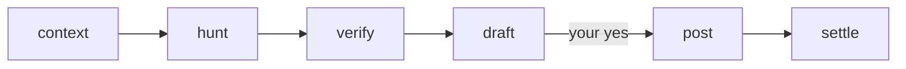

# review-pr

`/review-pr <PR|branch> [effort]` runs on its own through `draft`, then pauses once with a report, so you can start it and come back later. Nothing posts until you say yes. `effort` (`medium`, `max`, ...) goes to `/code-review` as is; without it, the skill picks `high` or `xhigh`. Findings are tracked in `<review_dir>/<target>/review.md`. The first run saves its settings to `.claude/review-pr.local.md` and adds its files to `.gitignore`, uncommitted, both in the main checkout. It needs the `pr-comments` skill installed too.

| Stage | Does |
|---|---|
| `context` | Reads the PR, ticket, specs and existing reviews, and writes a 3-line brief |
| `hunt` | Runs `/code-review` and records the findings |
| `verify` | Agents try to disprove each finding and re-rate its priority, checking MCPs (logs, DB, tracker) when the code can't settle it |
| `draft` | Writes the comments into `drafts.md` per `/pr-comments`, then shows the report: the verdict, findings, questions, optional replies and what was left out |
| `post` | Posts `drafts.md` once you say yes |
| `settle` | On a later run, after merge or the author's reply, saves rulings to `settled` |
