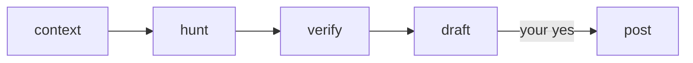

# review-pr

`/review-pr <PR|branch> [effort]` runs on its own through `draft`, then pauses once with a report, so you can start it and come back later. Nothing posts until you say yes. `effort` (`medium`, `max`, ...) goes to `/code-review` as is, and defaults to `xhigh`. It's a one-off: a run lives in one session and saves no state for a later one. Settings are optional, in `.claude/review-pr.local.md` in the main checkout, and are saved only when you accept the report's offer. It needs the `pr-comments` skill installed too.

| Stage | Does |
|---|---|
| `context` | Reads the PR, ticket, specs and existing reviews, and writes a 3-line brief |
| `hunt` | Runs `/code-review`, records the findings and rates them P0-P3 |
| `verify` | Agents try to disprove each finding and re-rate its priority, checking MCPs (logs, DB, tracker) when the code can't settle it |
| `draft` | Leaves out what a person already ruled on, writes the rest into `drafts-<target>.md` in the session's scratchpad per `/pr-comments`, then shows the report: the verdict, findings, P3s to pick from, questions, optional replies and what was left out |
| `post` | Posts the drafts once you say yes |
