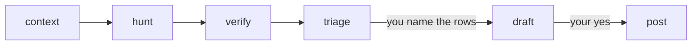

# review-pr

Runs a full PR review on its own, then stops at a table so you can filter the findings before any comment is written. Nothing posts until you say yes.

```
/review-pr <PR|branch> [effort] [unattended]
```

- `effort` (`medium`, `max`, ...) goes to `/code-review` as is, and defaults to `xhigh`.
- `unattended` drafts every confirmed finding first and pauses once, for a run you won't be around for.

It needs the `pr-comments` skill installed too.

## Flow



| Stage | Does |
|---|---|
| `context` | Reads the PR, ticket, specs and existing reviews, and writes a 3-line brief |
| `hunt` | Runs `/code-review`, records the findings and rates them P0-P3 |
| `verify` | Agents try to disprove each finding and re-rate its priority, checking MCPs (logs, DB, tracker) when the code can't settle it |
| `triage` | Marks what a person already ruled on, then shows the report: a table of the confirmed findings, short reasoning, what was left out, and which rows it would draft. You discuss and filter here |
| `draft` | Writes the rows you named into `drafts-<target>.md` in the session's scratchpad per `/pr-comments`, then shows the exact text for you to read or edit |
| `post` | Posts the drafts once you say yes |

With `unattended`, `triage` doesn't stop: `draft` covers every confirmed finding, with P3s and optional replies under their own headings, and the report carries the exact text.

## Settings

A run is a one-off: it lives in one session and saves no state for a later one. Settings are optional (`consumers`, `evidence`, `verify_cap`), live in `.claude/review-pr.local.md` in the main checkout, and are saved only when you accept the report's offer.
